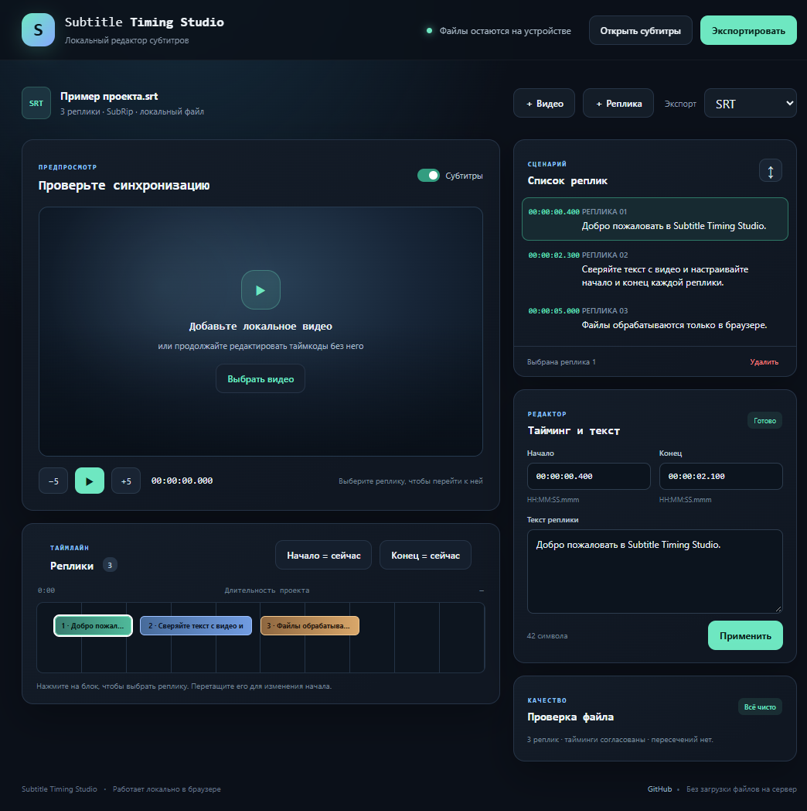

# Subtitle Timing Studio

**A local-first subtitle timing editor for SRT and WebVTT.** Preview subtitles against a video, adjust cue timing, inspect overlaps, and export a clean file. Your subtitle and video files stay in your browser.

[](https://github.com/GhosTnever-lkm/subtitle-timing-studio/actions/workflows/ci.yml)



## What it does

- Opens SubRip (`.srt`) and WebVTT (`.vtt`) captions, including multi-line cues and WebVTT cue settings.
- Previews captions over a video selected from your device. The browser reads it locally; the project has no upload endpoint.
- Edits cue text and millisecond-precision in/out points; sets an edge from the current video position; seeks from the cue list.
- Adds, removes, sorts, and drags timeline cues to shift their timing.
- Reports invalid timing, overlap, and duplicate cue IDs before export.
- Exports SRT or WebVTT while retaining cue identifiers and WebVTT settings where supported.
- Offers keyboard shortcuts: `Ctrl/Cmd + O` opens subtitles; `Ctrl/Cmd + S` exports; `Delete` removes the selected cue when focus is outside the text editor.

## Run locally

Requires Node.js 20 or newer. No package installation is needed.

```sh
npm start
```

Open <http://127.0.0.1:4173>. The included sample appears when the app starts. Use the local server; opening the HTML with `file://` may be blocked by browser ES-module rules.

## Check the project

```sh
npm test
npm run check
```

The parser and validation core has no runtime dependencies. Tests cover SRT/WebVTT parsing and round-trips, malformed-block recovery, large timecodes, optional WebVTT IDs, out-of-order cues, non-adjacent overlaps, and non-mutating validation.

## Privacy and limits

Files are read with browser file APIs and video object URLs; this app does not upload, store, or transmit them. The development server binds only to `127.0.0.1`. Browser support for video playback depends on the codecs available on the user's device. It edits subtitle timing and text; it does not transcribe, translate, burn captions into video, or verify how a particular media player renders every styling tag. SRT has no standard cue-settings field, so WebVTT-specific settings are not represented in SRT exports.

## License

MIT. See [LICENSE](LICENSE).
